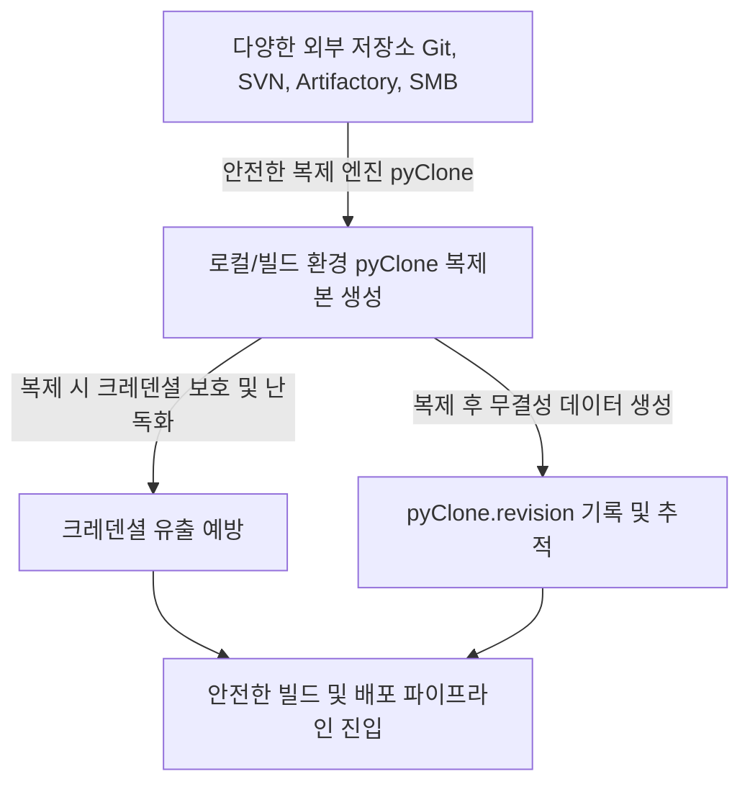
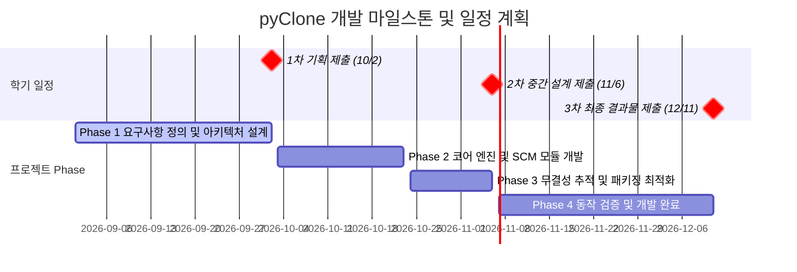

# 📝 [1차] 프로젝트 기획서: pyClone
---

- [📝 \[1차\] 프로젝트 기획서: pyClone](#-1차-프로젝트-기획서-pyclone)
  - [1. 프로젝트 주제](#1-프로젝트-주제)
  - [2. 프로젝트 내용](#2-프로젝트-내용)
    - [2.1 선정 배경 및 필요성 (소프트웨어 공급망 보안 이슈와의 연관성)](#21-선정-배경-및-필요성-소프트웨어-공급망-보안-이슈와의-연관성)
    - [2.2 핵심 기능 및 아키텍처 설계](#22-핵심-기능-및-아키텍처-설계)
  - [3. 프로젝트 진행일정](#3-프로젝트-진행일정)
  - [4. 기대 효과 및 활용 방안](#4-기대-효과-및-활용-방안)

---

본 문서는 다중 SCM 환경에서 소스코드를 안전하게 체크아웃하고 추적성을 확보하기 위한 **pyClone** 도구의 **설계 및 개발 방안**을 정의합니다.

---

## 1. 프로젝트 주제

**"소프트웨어 공급망 보안을 고려한 다중 SCM(SVN, Git, Artifactory, SMB) 통합 복제 및 무결성 추적 자동화 도구 (pyClone) 개발"**

- **약칭 및 도구명**: `pyClone`
- **개발 환경**: Python 3.9+ (Cross-platform 지원: Windows, Linux)

---

## 2. 프로젝트 내용

### 2.1 선정 배경 및 필요성 (소프트웨어 공급망 보안 이슈와의 연관성)

현대의 소프트웨어 개발 환경은 다양한 외부 저장소 및 오픈소스 패키지에 깊이 의존하고 있어, 이를 노린 **소프트웨어 공급망 공격(Software Supply Chain Attack)**이 급증하고 있습니다. 2020년 SolarWinds 사태, 3CX Desktop App 공급망 감염 사고, 그리고 최근 발생한 `XZ Utils 백도어 삽입 사태` 등은 신뢰 관계를 악용한 소스코드 오염 위협이 심각하다는 것을 여실히 보여줍니다.

특히, 빌드 서버나 개발자 PC가 소스코드를 처음 반입하는 **체크아웃(복제) 단계에서 악성 코드나 비인가 접근으로 인한 오염이 발생하기 쉽습니다.**

따라서 다중 SCM(Git, SVN, Artifactory, SMB 등) 환경을 통합 통제하고, 소스코드 획득 시점부터 크레덴셜 보안과 무결성 검증을 유기적으로 수행하는 **새로운 보안형 체크아웃 자동화 도구인 `pyClone`을 개발**하고자 합니다.

### 2.2 핵심 기능 및 아키텍처 설계

1. **독자적인 다중 SCM(Multi-SCM) 어댑터 엔진 설계**
   - 상이한 명령 체계를 갖는 Git, SVN, HTTP 기반의 Artifactory, SMB 공유 네트워크 저장소를 단일화된 코어 설정 파일과 CLI 인터페이스로 제어하는 통합 어댑터 구조를 설계 및 구현합니다.
2. **크레덴셜 보호 보안 모듈 구현**
   - 설정 파일 내 비밀번호 노출을 원천 차단하기 위해, 독자적인 난독화/복호화 모듈을 설계 및 탑재하여 외부 저장소 접근 권한 유출을 미연에 방지합니다.
3. **무결성 추적 메타데이터 관리 기능 (`pyClone.revision`)**
   - 소스코드 복제 성공 시, `pyClone.cfg`와 동일한 포맷으로 Git Commit Hash 및 SVN Revision 번호로 대치하고 ATF/SMB는 `HEAD`로 고정한 `pyClone.revision` 메타데이터 파일을 자동 생성하여, 디버깅 및 유지보수 시 과거 특정 빌드 형상을 그대로 복원하는 롤백 빌드(Rollback Build)와 원본의 이력 추적성(Provenance)을 완벽히 보장합니다.

---

## 3. 프로젝트 진행일정

본 과제는 학기 세부 일정(기획 - 설계 - 최종보고)에 맞춰 다음과 같이 4개 Phase로 세분화하여 개발이 진행됩니다.

| 마일스톤                                         | 진행 기간     | 주요 작업 내용                                                                                                                                                                               | 산출물                          |
| :----------------------------------------------- | :------------ | :------------------------------------------------------------------------------------------------------------------------------------------------------------------------------------------- | :------------------------------ |
| **Phase 1: 요구사항 정의 및 기초 아키텍처 설계** | 09.01 ~ 10.02 | - 다중 SCM 연동 프로토콜 분석 및 요구사항 명세 작성 - `pyClone` 코어 엔진 구조 및 디렉토리 레이아웃 확립 - 설정 파서 및 기초 단위 테스트 설계 - **1차 프로젝트 기획서 제출 (10/2)** | 프로젝트 기획서                 |
| **Phase 2: 코어 엔진 및 SCM 연동 모듈 개발**     | 10.03 ~ 10.23 | - Git, SVN, Artifactory, SMB 연동 어댑터 개발 - 크레덴셜 암호화/보안 모듈 설계 및 구현 - 예외 처리 프레임워크 및 로깅 시스템 탑재                                                      | 설계서(SDS)                     |
| **Phase 3: 무결성 추적 및 패키징 최적화**        | 10.24 ~ 11.06 | - 리비전 정보 생성 모듈 및 `pyClone.revision` 기록기 구현 - 배포 패키지(`pyclone/` 모듈) 구조 설계 및 최적화 - **2차 프로젝트 설계 (중간보고) 제출 (11/6)**                            | 중간보고서, 프로토타입          |
| **Phase 4: 동작 검증 및 개발 완료**              | 11.07 ~ 12.11 | - 테스트 스크립트 작성 - 동작 검증 및 자동화 테스트 - **3차 최종 개발 완료 및 발표(최종보고) 제출 (12/11)**                                                                            | 최종보고서, 소스코드, 시연 영상 |

---

## 4. 기대 효과 및 활용 방안

1. **소프트웨어 공급망 시점에서의 선제적 보안 방어**
   - 저장소 크레덴셜 노출 위험을 원천 방어하고, 소스코드 다운로드 시 무결성 검사를 수행하여 비인가 코드 유입을 사전에 방지합니다.
2. **이종 SCM 복제 작업의 표준화**
   - SVN, Git, Artifactory, SMB 등의 복잡한 저장소 환경을 일관된 구조로 추상화하여, 개발 운영의 편의성과 시스템 확장성을 크게 제고합니다.
3. **무결성 기반의 투명한 소프트웨어 품질 보증 및 신속한 롤백 대응**
   - 체크아웃된 소스코드의 명확한 리비전 메타데이터(`pyClone.revision`)를 `pyClone.cfg`와 동일한 포맷으로 제공함으로써, 장애 발생 시 신속한 롤백 빌드 및 디버깅 환경을 구축하여 신뢰도 높은 소프트웨어 배포 체계를 성립합니다.
