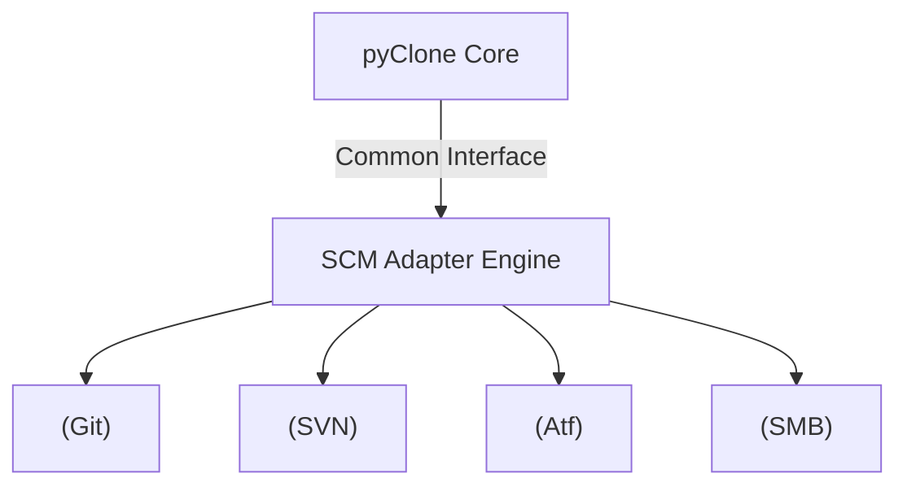

# 소프트웨어 요구사항 명세서 (SRS): pyClone
---

- [소프트웨어 요구사항 명세서 (SRS): pyClone](#소프트웨어-요구사항-명세서-srs-pyclone)
  - [1. 소개 (Introduction)](#1-소개-introduction)
    - [1.1 목적 (Purpose)](#11-목적-purpose)
    - [1.2 시스템 범위 (Scope)](#12-시스템-범위-scope)
    - [1.3 참조 문서 (References)](#13-참조-문서-references)
  - [2. 시스템 전반 설명 (General Description)](#2-시스템-전반-설명-general-description)
    - [2.1 제품 관점 (Product Perspective)](#21-제품-관점-product-perspective)
    - [2.2 사용자 특성 (User Characteristics)](#22-사용자-특성-user-characteristics)
    - [2.3 제약 사항 (Constraints)](#23-제약-사항-constraints)
  - [3. 기능 요구사항 (Functional Requirements)](#3-기능-요구사항-functional-requirements)
    - [3.1 설정 파서 및 명령행 인터페이스 (CLI)](#31-설정-파서-및-명령행-인터페이스-cli)
      - [FR-001: CLI 실행 매개변수 지원](#fr-001-cli-실행-매개변수-지원)
      - [FR-002: 파라미터 파싱 및 옵션 저장](#fr-002-파라미터-파싱-및-옵션-저장)
      - [FR-003: 통합 설정 파일(pyClone.cfg) 처리 및 문법 파싱](#fr-003-통합-설정-파일pyclonecfg-처리-및-문법-파싱)
    - [3.2 SCM 어댑터 기반 복제 엔진](#32-scm-어댑터-기반-복제-엔진)
      - [FR-004: Git 어댑터 기능](#fr-004-git-어댑터-기능)
      - [FR-005: SVN 어댑터 기능](#fr-005-svn-어댑터-기능)
      - [FR-006: Artifactory (HTTP/HTTPS) 파일 다운로드 기능](#fr-006-artifactory-httphttps-파일-다운로드-기능)
      - [FR-007: SMB 공유 폴더 어댑터 기능](#fr-007-smb-공유-폴더-어댑터-기능)
    - [3.3 크레덴셜 보안 모듈](#33-크레덴셜-보안-모듈)
      - [FR-008: 비밀번호 난독화 및 복호화 유틸리티](#fr-008-비밀번호-난독화-및-복호화-유틸리티)
      - [FR-009: 난독화 입력값의 실시간 해독 및 인증 연동](#fr-009-난독화-입력값의-실시간-해독-및-인증-연동)
    - [3.4 무결성 검증 및 실행 결과 출력](#34-무결성-검증-및-실행-결과-출력)
      - [FR-010: 이력 추적 및 무결성 메타데이터 생성 (`pyClone.revision`)](#fr-010-이력-추적-및-무결성-메타데이터-생성-pyclonerevision)
      - [FR-011: 실시간 표준 스트림 출력](#fr-011-실시간-표준-스트림-출력)
      - [FR-012: 소스코드 변경 이력 및 위변조 검증](#fr-012-소스코드-변경-이력-및-위변조-검증)
  - [4. 비기능 요구사항 (Non-functional Requirements)](#4-비기능-요구사항-non-functional-requirements)
    - [4.1 이식성 및 환경 제약 (Portability)](#41-이식성-및-환경-제약-portability)
    - [4.2 신뢰성 및 예외 처리 (Reliability)](#42-신뢰성-및-예외-처리-reliability)
    - [4.3 성능 및 사용성 (Performance \& Usability)](#43-성능-및-사용성-performance--usability)
  - [5. 외부 인터페이스 및 가정](#5-외부-인터페이스-및-가정)
    - [5.1 외부 프로그램 의존성](#51-외부-프로그램-의존성)
    - [5.2 제약 사항 및 개발 가정](#52-제약-사항-및-개발-가정)

---

## 1. 소개 (Introduction)

### 1.1 목적 (Purpose)
본 요구사항 명세서(SRS)는 소프트웨어 공급망 보안과 효율적인 개발 운영 관리를 지원하는 다중 SCM 통합 복제 도구인 **pyClone**의 기능적 및 비기능적 요구사항을 명확히 정의합니다. 본 문서는 시스템 개발 및 중간/최종 평가 단계에서 개발 범위 설정 및 검증 기준으로 활용됩니다.

### 1.2 시스템 범위 (Scope)
- **다중 저장소 복제**: SVN, Git, Artifactory(HTTP/HTTPS), SMB 공유 폴더 등 이종 SCM 저장소로부터 소스코드 및 바이너리 아티팩트를 안전하게 가져와 지정된 로컬 경로에 일관성 있게 배치합니다.
- **크레덴셜 보호**: 설정 파일과 외부 입력 매개변수에 포함될 수 있는 비밀번호를 평문으로 노출하지 않고, 복호화가 가능한 전용 난독화 처리를 통해 인증 정보를 보호합니다.
- **무결성 추적 및 이력화**: 다중 복제 완료 시점의 원천 형상 정보(커밋 해시, SCM URL, 작업자 정보 등)와 복제된 개별 소스 파일의 SHA-256 체크섬 해시맵을 수집하여 `pyClone.revision` 메타데이터 파일에 영구 기록합니다. 또한, 이전 복제 이력 대조를 통해 소스코드의 임의 변조 여부를 교차 검증함으로써 신뢰성 높은 반입 이력을 보장합니다.

### 1.3 참조 문서 (References)
- `01_Project_Proposal.md` : pyClone 프로젝트 기획서

---

## 2. 시스템 전반 설명 (General Description)

### 2.1 제품 관점 (Product Perspective)
- **독립형 CLI 도구**: 별도의 웹 서버나 무거운 인프라 없이 단일 Python 유틸리티 스크립트 실행으로 동작합니다.
- **어댑터 구조 (Adapter Pattern)**: 코어 엔진은 각 SCM 프로토콜에 의존하지 않으며, 공통 어댑터 인터페이스를 통해 하위 SCM 구현체(Git, SVN, Artifactory, SMB)를 동적으로 실행합니다.

### 2.2 사용자 특성 (User Characteristics)
- **배포 및 DevOps 엔지니어**: CI/CD 파이프라인 상에서 이종 저장소의 통합 반입 스크립트로 도구를 사용합니다.
- **소프트웨어 개발자**: 다중 리포지토리로 분할된 대규모 프로젝트 환경에서 로컬 소스코드를 동기화하기 위한 복제 도구로 활용합니다.

### 2.3 제약 사항 (Constraints)
- **실행 환경**: Python 3.9 이상 버전이 설치된 다중 OS(Windows, Linux/macOS) 환경에서 구동되어야 합니다.
- **인프라 의존성**: 복제를 실행하는 시스템에 외부 클라이언트 CLI 도구(`git`, `svn`, `curl`, SMB 드라이브 마운트 환경 등)가 사전 준비되어 있어야 합니다.

---

## 3. 기능 요구사항 (Functional Requirements)

### 3.1 설정 파서 및 명령행 인터페이스 (CLI)

#### FR-001: CLI 실행 매개변수 지원
- 시스템은 다음과 같은 단독 실행 매개변수 형식을 지원해야 한다.
  - `python pyClone.py [-f] URL[@REV] [PATH] [OPTIONS]`
- `URL` SCM의 위치 또는 `-f/--file` 지정 시 로컬/원격 설정 파일 경로를 나타낸다.
- `REV`는 선택적 특정 리비전 지정 값이며, 미지정 시 기본값은 `HEAD`이다.
- `PATH`는 복제 결과물이 저장될 로컬 디렉터리를 가리킨다.

#### FR-002: 파라미터 파싱 및 옵션 저장
- 시스템은 크레덴셜 파라미터 및 실행 동작 제어를 위한 다음 옵션들을 처리하고 설정 객체에 반영해야 한다.
  - `-f, --file`: 입력 인자를 단일 URL이 아닌 통합 설정 파일 경로로 해석한다.
  - `--username, --password`: 기본 인증을 위한 공통 계정 및 비밀번호.
  - `--git-username, --git-password`: Git 전용 계정 정보.
  - `--smb-username, --smb-password`: SMB 전용 계정 정보.
  - `--encpassword`: 전달된 패스워드 인자가 난독화된 텍스트임을 정의한다.
  - `--retry`: 연결 지연이나 통신 장애 시 재시도 횟수를 지정한다 (기본값: 0).

#### FR-003: 통합 설정 파일(pyClone.cfg) 처리 및 문법 파싱
- 시스템은 `-f` 옵션 지정을 통해 여러 저장소를 명시한 `pyClone.cfg` 파일을 순차적으로 해석할 수 있어야 한다.
- 설정 파일 각 유효 라인은 다음 형식으로 표기되며, 시스템은 이를 파싱하여 구조화된 데이터 구조로 로드해야 한다.
  - `[TYPE,]REVISION  "SOURCE_URL"  ["TARGET_PATH"]`
  - `TYPE`은 기본적으로 `svn`을 지원하되, 명시적으로 `git`, `atf`, `smb`로 구분 가능하다.

---

### 3.2 SCM 어댑터 기반 복제 엔진

#### FR-004: Git 어댑터 기능
- 시스템은 `git` 타입 항목에 대해 다음 동작을 보장해야 한다.
  - 지정 경로에 로컬 Git 저장소가 없는 경우 `git clone --recurse-submodules`를 수행하여 초기 다운로드한다.
  - 로컬 Git 저장소가 이미 존재하는 경우, 기존 브랜치 상태를 보존하되 원격 저장소 내용을 동기화하기 위해 `git fetch` 및 `git checkout`, `git pull`을 순차적으로 수행한다.

#### FR-005: SVN 어댑터 기능
- 시스템은 `svn` 타입 항목에 대해 다음 동작을 보장해야 한다.
  - 지정 경로에 SVN 작업 복사본이 없을 경우 `svn checkout`을 통해 소스를 받아온다.
  - 이미 복사본이 존재하는 경우, 빠른 처리를 위해 `svn update`를 우선 시도한다.

#### FR-006: Artifactory (HTTP/HTTPS) 파일 다운로드 기능
- HTTP/HTTPS 프로토콜 기반의 바이너리 저장소(`atf` 타입)로부터 파일을 로컬로 다운로드해야 한다.
- 파일의 전송 안전성을 보장하기 위해 `curl` 혹은 내장 HTTP 라이브러리를 통해 수신하며, 다운로드 성공 여부를 HTTP 응답 코드로 검증한다.

#### FR-007: SMB 공유 폴더 어댑터 기능
- 원격 SMB 파일 공유 시스템(`smb` 타입)에 접속하여 파일 및 디렉터리 구조를 로컬 경로로 안전하게 복사해야 한다.
- 네트워크 연결 및 복사 수행 완료 후에는 드라이브 세션을 끊고 마운트 설정을 자가 회수(unmount)해야 한다.

---

### 3.3 크레덴셜 보안 모듈

#### FR-008: 비밀번호 난독화 및 복호화 유틸리티
- 시스템은 보안 취약성이 높은 소스코드 유출을 보조 방어하기 위해 비밀번호 난독화 처리 기능(`weak_enc_pass`)과 이를 해독하는 기능(`_weak_dec_pass`)을 내부 모듈로 내장해야 한다.
- 설정 파일이나 매개변수 전송 시 해당 모듈로 인코딩된 비밀번호 데이터만을 전송하도록 유도한다.

#### FR-009: 난독화 입력값의 실시간 해독 및 인증 연동
- `--encpassword` 옵션과 함께 비밀번호가 전달될 시, 코어 엔진은 실제 SCM 연결을 호출하기 직전에만 메모리 상에서 난독화를 해독하여 외부 도구에 파라미터로 주입하고 사용 완료 후 해당 메모리를 파기해야 한다.

---

### 3.4 무결성 검증 및 실행 결과 출력

#### FR-010: 이력 추적 및 무결성 메타데이터 생성 (`pyClone.revision`)
- 모든 SCM에 대한 다운로드 및 복제가 정상적으로 완료되면, 각 복제 항목별 최종 동기화 완료 원천 정보(Git Commit Hash, SVN Revision, HTTP 파일 크기 및 수신 시간, SCM 원격 URL, 작업자 계정)와 복제된 모든 파일의 **상대 경로 및 SHA-256 체크섬 해시맵**을 결합한 `pyClone.revision` 파일을 JSON/YAML 구조화 포맷으로 생성해야 한다.
- 복제 시 단 하나라도 실패 항목이 발생할 시 무결성이 깨진 것으로 간주하여 `pyClone.revision` 파일 생성을 전면 취소하고, 기존 잔존 파일이 있을 경우 삭제해야 한다.

#### FR-011: 실시간 표준 스트림 출력
- 복제가 진행되는 동안 각 SCM 어댑터가 호출하는 명령행 및 다운로드 진행률이 표준 출력(stdout)을 통해 버퍼링 없이 실시간으로 스트리밍되어 사용자에게 정보가 시각화되어야 한다.

#### FR-012: 소스코드 변경 이력 및 위변조 검증
- 시스템은 복제 수행 전 혹은 수행 과정에서 기존 로컬 디렉터리에 존재하는 `pyClone.revision` 파일 내 SHA-256 파일 해시맵과 실제 로컬 디스크 상의 소스코드 상태를 비교/대조해야 한다.
- 대조 결과 임의로 위변조, 변경, 추가 혹은 삭제된 소스 파일이 검출될 경우, 변경 이력 리스트를 터미널 경고 로그로 출력하고 시스템 예외(`CCheckoutError` 등)를 발생시켜 오염된 소스코드가 빌드 파이프라인으로 유입되는 것을 방지해야 한다.

---

## 4. 비기능 요구사항 (Non-functional Requirements)

### 4.1 이식성 및 환경 제약 (Portability)
- **NFR-001 (OS 이식성)**: Windows 환경뿐만 아니라 UNIX/Linux 및 macOS 환경에서도 동일하게 동작해야 하며, 경로 구분자(`/` vs `\`) 및 OS별 마운트 명령어 체계를 플랫폼 정보를 판별하여 능동적으로 분기 처리해야 한다.

### 4.2 신뢰성 및 예외 처리 (Reliability)
- **NFR-002 (일관된 예외 처리)**: 특정 모듈이나 SCM 연동에서 예상치 못한 오류 발생 시 전체 프로세스가 오동작하지 않고, 표준 정의된 공통 에러 객체(`pyCloneError` 및 하위 예외군)로 캡슐화하여 터미널에 사용자 식별이 가능한 형태로 안전하게 로깅되어야 한다.
- **NFR-003 (네트워크 재시도 체계)**: 일시적인 네트워크 순단이나 다운로드 실패에 대비하기 위해 `--retry` 파라미터에서 명시한 설정값만큼 지수 대기 간격(Exponential Backoff)으로 재접속을 안전하게 시도한다.

### 4.3 성능 및 사용성 (Performance & Usability)
- **NFR-004 (안내 및 도움말)**: 사용자가 매개변수 없이 CLI를 실행하거나 올바르지 않은 명령 인자를 입력했을 경우 가이드라인 및 도움말(Help Message)을 명확하게 화면에 시각화하여 사용성을 제고한다.

---

## 5. 외부 인터페이스 및 가정

### 5.1 외부 프로그램 의존성
시스템은 해당 운영체제에 설치된 다음 외부 CLI 도구들의 경로를 자동으로 감지하여 내부 프로세스로 제어한다.
- `git`: 분산 형상 관리 클라이언트
- `svn`: 중앙 형상 관리 클라이언트
- `curl`: HTTP/HTTPS 전송 유틸리티
- `net` 또는 `mount/mount_smbfs`: SMB 마운트를 위한 OS 제공 명령어

### 5.2 제약 사항 및 개발 가정
- 크레덴셜 정보 관리는 보안 기준에 근거해 메모리 스택 유출이 일어나지 않도록 제어하지만, 시스템이 제공하는 암호 난독화(`weakpass`) 모듈은 암호학적 공격에 강인한 수준이 아니므로 비공개 네트워크나 안전한 통제 영역 내에서 배포 및 사용함을 전제로 설계한다.
