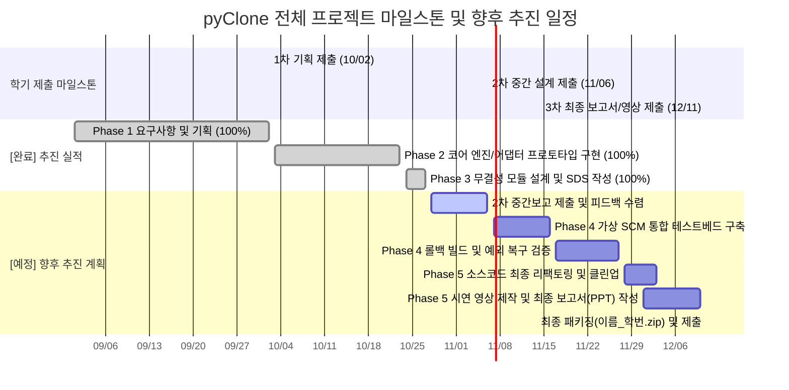
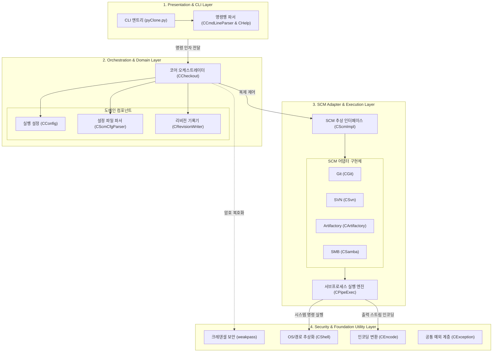
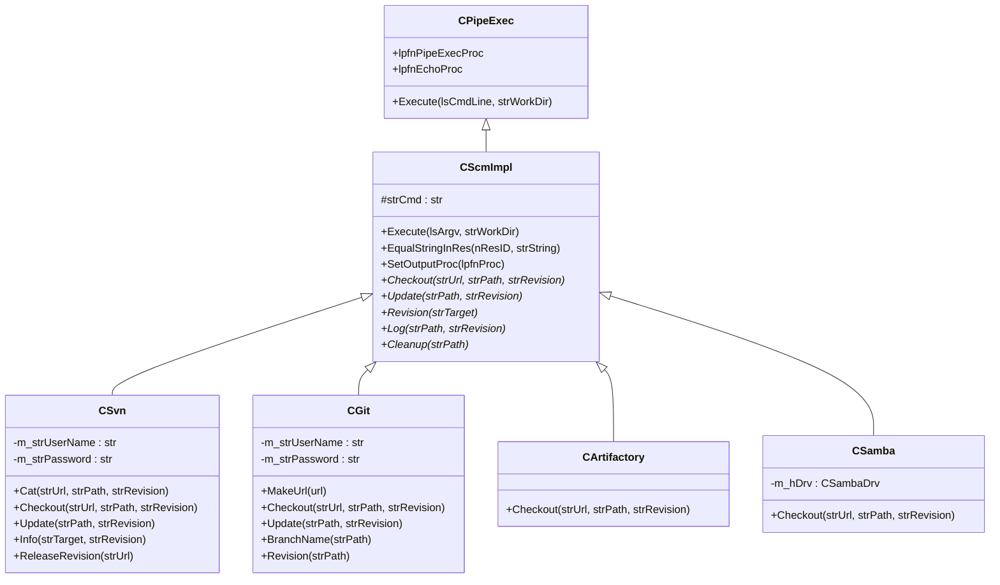
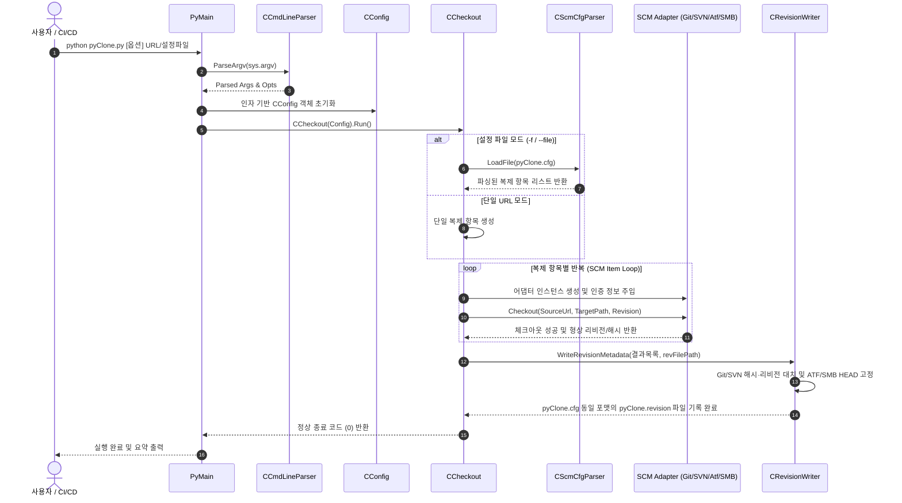
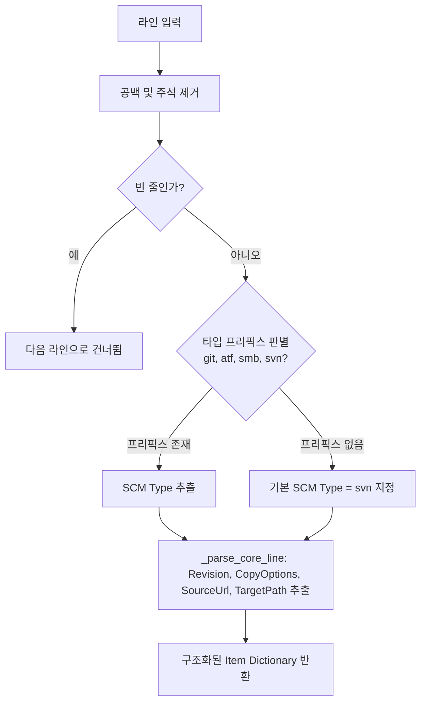
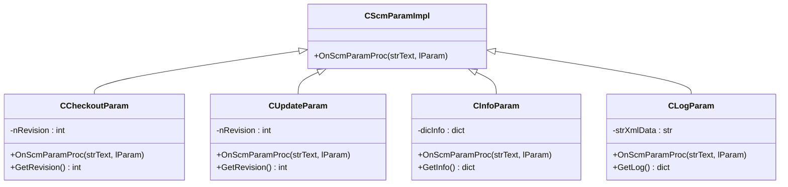
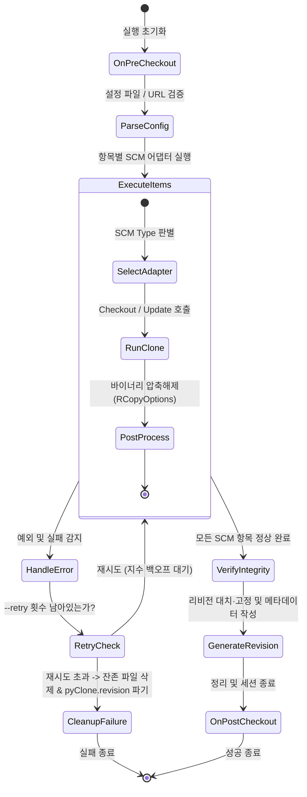
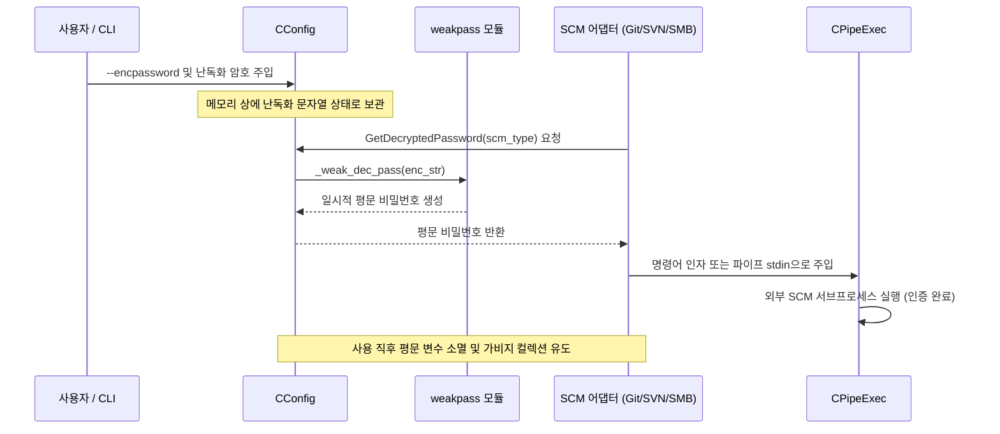
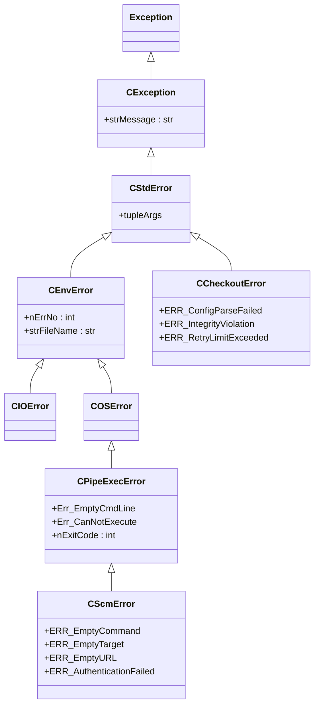

# 소프트웨어 설계 명세서 (SDS): pyClone
---

- [소프트웨어 설계 명세서 (SDS): pyClone](#소프트웨어-설계-명세서-sds-pyclone)
  - [1. 소개 및 프로젝트 추진 현황 (Introduction \& Progress Summary)](#1-소개-및-프로젝트-추진-현황-introduction--progress-summary)
    - [1.1 문서 목적 (Purpose)](#11-문서-목적-purpose)
    - [1.2 프로젝트 개요 (지난 기획서 제출내용 대비 업데이트 된 내용)](#12-프로젝트-개요-지난-기획서-제출내용-대비-업데이트-된-내용)
      - [1.2.1 1차 기획서 핵심 내용 요약](#121-1차-기획서-핵심-내용-요약)
      - [1.2.2 1차 기획서 대비 주요 업데이트 및 구체화 내용](#122-1차-기획서-대비-주요-업데이트-및-구체화-내용)
    - [1.3 프로젝트 진행 내용 (일정별 진행 내용)](#13-프로젝트-진행-내용-일정별-진행-내용)
      - [1.3.1 단계별 세부 진행 실적](#131-단계별-세부-진행-실적)
      - [1.3.2 마일스톤별 달성 현황표](#132-마일스톤별-달성-현황표)
    - [1.4 향후 계획 (일정별 진행 예정 내용)](#14-향후-계획-일정별-진행-예정-내용)
      - [1.4.1 단계별 세부 추진 예정 내용](#141-단계별-세부-추진-예정-내용)
    - [1.5 시스템 범위 (Scope)](#15-시스템-범위-scope)
    - [1.6 설계 원칙 및 아키텍처 목표 (Design Principles \& Goals)](#16-설계-원칙-및-아키텍처-목표-design-principles--goals)
    - [1.7 참조 문서 (References)](#17-참조-문서-references)
  - [2. 시스템 아키텍처 (System Architecture)](#2-시스템-아키텍처-system-architecture)
    - [2.1 계층형 아키텍처 (Layered Architecture)](#21-계층형-아키텍처-layered-architecture)
    - [2.2 어댑터 패턴 기반 다중 SCM 복제 구조 (Adapter Pattern)](#22-어댑터-패턴-기반-다중-scm-복제-구조-adapter-pattern)
    - [2.3 전체 실행 흐름도 (End-to-End Execution Flow)](#23-전체-실행-흐름도-end-to-end-execution-flow)
  - [3. 컴포넌트 및 모듈별 상세 설계 (Detailed Component Design)](#3-컴포넌트-및-모듈별-상세-설계-detailed-component-design)
    - [3.1 CLI 파서 및 설정 관리 모듈 (`CCmdLineParser`, `CConfig`)](#31-cli-파서-및-설정-관리-모듈-ccmdlineparser-cconfig)
      - [3.1.1 `CParseCmdLine` 및 `CCmdLineParser`](#311-cparsecmdline-및-ccmdlineparser)
      - [3.1.2 `CConfig`](#312-cconfig)
    - [3.2 설정 파일 파서 모듈 (`CScmCfgParser`)](#32-설정-파일-파서-모듈-cscmcfgparser)
    - [3.3 SCM 코어 실행 엔진 및 파이프 유틸리티 (`CPipeExec`, `CEncode`)](#33-scm-코어-실행-엔진-및-파이프-유틸리티-cpipeexec-cencode)
      - [3.3.1 `CPipeExec`](#331-cpipeexec)
      - [3.3.2 `CEncode`](#332-cencode)
    - [3.4 SCM 추상 계층 및 파라미터 파서 (`CScmImpl`, `CScmParamImpl`)](#34-scm-추상-계층-및-파라미터-파서-cscmimpl-cscmparamimpl)
    - [3.5 개별 SCM 어댑터 상세 구현](#35-개별-scm-어댑터-상세-구현)
      - [3.5.1 Git 어댑터 (`CGit`)](#351-git-어댑터-cgit)
      - [3.5.2 SVN 어댑터 (`CSvn`)](#352-svn-어댑터-csvn)
      - [3.5.3 Artifactory 바이너리 어댑터 (`CArtifactory`)](#353-artifactory-바이너리-어댑터-cartifactory)
      - [3.5.4 SMB 네트워크 어댑터 (`CSambaDrv`, `CSamba`, `CXFileCopy`)](#354-smb-네트워크-어댑터-csambadrv-csamba-cxfilecopy)
    - [3.6 오케스트레이션 및 라이프사이클 엔진 (`CCheckout`)](#36-오케스트레이션-및-라이프사이클-엔진-ccheckout)
    - [3.7 형상 이력 추적 및 리비전 메타데이터 관리 (`pyClone.revision`)](#37-형상-이력-추적-및-리비전-메타데이터-관리-pyclonerevision)
    - [3.8 크레덴셜 보안 모듈 (`weakpass`)](#38-크레덴셜-보안-모듈-weakpass)
  - [4. 자료구조 및 데이터 포맷 명세 (Data Structures \& File Formats)](#4-자료구조-및-데이터-포맷-명세-data-structures--file-formats)
    - [4.1 통합 설정 파일 포맷 (`pyClone.cfg`)](#41-통합-설정-파일-포맷-pyclonecfg)
      - [작성 예시 (`pyClone.cfg`):](#작성-예시-pyclonecfg)
    - [4.2 무결성 메타데이터 스키마 (`pyClone.revision`)](#42-무결성-메타데이터-스키마-pyclonerevision)
      - [포맷 동일화 설계 배경: 디버깅 및 유지보수용 롤백 빌드(Rollback Build) 지원](#포맷-동일화-설계-배경-디버깅-및-유지보수용-롤백-빌드rollback-build-지원)
      - [리비전 대치 및 고정 규칙](#리비전-대치-및-고정-규칙)
      - [포맷 문법:](#포맷-문법)
      - [생성 예시 (`pyClone.revision`):](#생성-예시-pyclonerevision)
  - [5. 보안 아키텍처 (Security Architecture)](#5-보안-아키텍처-security-architecture)
    - [5.1 크레덴셜 생명주기 및 메모리 보호 흐름](#51-크레덴셜-생명주기-및-메모리-보호-흐름)
  - [6. 예외 처리 및 신뢰성 설계 (Exception Handling \& Reliability)](#6-예외-처리-및-신뢰성-설계-exception-handling--reliability)
    - [6.1 예외 클래스 상속 계층도](#61-예외-클래스-상속-계층도)
    - [6.2 네트워크 순단 대비 재시도(Retry) 메커니즘](#62-네트워크-순단-대비-재시도retry-메커니즘)
  - [7. 요구사항 추적성 매트릭스 (Requirements Traceability Matrix)](#7-요구사항-추적성-매트릭스-requirements-traceability-matrix)

---

## 1. 소개 및 프로젝트 추진 현황 (Introduction & Progress Summary)

### 1.1 문서 목적 (Purpose)
본 소프트웨어 설계 명세서(Software Design Specification, SDS)는 소프트웨어 요구사항 명세서(`02_Software_Requirements_Specification.md`)에 정의된 기능 및 비기능 요구사항을 충족하기 위한 **pyClone** 시스템의 아키텍처, 컴포넌트 구조, 클래스 설계, 데이터 포맷, 보안 메커니즘 및 상세 동작 흐름을 기술합니다. 또한 본 문서는 **[2차] 프로젝트 설계(중간보고)** 평가 기준에 따라 지난 1차 기획서 대비 업데이트된 내용, 일정별 실제 진행된 추진 실적, 향후 세부 개발 및 발표 계획을 종합적으로 기술합니다.

### 1.2 프로젝트 개요 (지난 기획서 제출내용 대비 업데이트 된 내용)

#### 1.2.1 1차 기획서 핵심 내용 요약
- **프로젝트 주제**: "소프트웨어 공급망 보안을 고려한 다중 SCM(SVN, Git, Artifactory, SMB) 통합 복제 및 무결성 추적 자동화 도구 (`pyClone`) 개발"
- **기획 배경 및 필요성**: 현대 소프트웨어 개발에서 급증하는 소프트웨어 공급망 공격(SolarWinds, 3CX, XZ Utils 사태 등)에 대응하여, 소스코드 및 바이너리 아티팩트를 초기 반입(Check-out)하는 단계에서부터 외부 침투 및 비인가 코드 유입을 차단하고 인증 정보를 보호하는 전용 보안 복제 도구 필요성 제기.
- **초기 제안 기능**: 어댑터 패턴 기반 다중 SCM(Git, SVN, Artifactory, SMB) 단일 CLI 제어, `weakpass` 기반 크레덴셜 난독화, 복제 완료 후 형상 추적을 위한 `pyClone.revision` 메타데이터 파일 생성.

#### 1.2.2 1차 기획서 대비 주요 업데이트 및 구체화 내용
설계 단계 및 프로토타입 구현 과정을 거치며 기획서의 개념적 요구사항이 다음과 같이 대폭 구체화 및 고도화되었습니다.

| 구분                           | 1차 기획서 제출 내용                       | 2차 설계서 업데이트 내용 (개선 및 구체화)                                                                                                                                                                                                                                         | 관련 SDS 절      |
| :----------------------------- | :----------------------------------------- | :-------------------------------------------------------------------------------------------------------------------------------------------------------------------------------------------------------------------------------------------------------------------------------- | :--------------- |
| **시스템 아키텍처**            | 개념적 SCM 어댑터 구조 수준 제시           | **4계층(Layered Architecture) 객체지향 분리 확립**<br>- Presentation(CLI), Orchestration, SCM Adapter, Security/Utility 4개 계층으로 엄격히 분리하여 결합도 최소화 및 모듈 확장성 극대화                                                                                          | [2.1절], [3장]   |
| **무결성 추적 및 롤백 빌드**   | 복제 완료 후 단순 메타데이터 기록으로 제안 | **완전한 롤백 빌드(Rollback Build) 스펙 정밀화**<br>- `pyClone.revision` 포맷을 `pyClone.cfg`와 100% 동일한 행 기반 포맷으로 규격화하여 재실행(`pyClone -f pyClone.revision`)만으로 과거 빌드 시점 복원 보장<br>- Git: Commit Hash, SVN: Revision, ATF/SMB: HEAD 정규화 규칙 확립 | [3.7절], [4.2절] |
| **크레덴셜 보안 라이프사이클** | `weakpass` 난독화/복호화 알고리즘 제시     | **메모리 수명주기 보호 프로토콜 구체화**<br>- 디스크/CLI는 난독화된 값(`--encpassword`)만 유지<br>- SCM 명령 호출 직전 메모리에서 복호화 후, 프로세스 반환 즉시 메모리 소거(Zeroing) 처리 설계                                                                                    | [3.8절], [5.1절] |
| **신뢰성 및 결함 복구**        | 단일 명령 실행 중심 설계                   | **지수 백오프(Exponential Backoff) 기반 재시도 및 표준 예외 체계**<br>- 네트워크 순단 대비 `--retry N` 재시도 메커니즘 설계<br>- 일관된 예외 계층(`pyCloneError` 상속 트리) 정의                                                                                                  | [6.1절], [6.2절] |

---

### 1.3 프로젝트 진행 내용 (일정별 진행 내용)

본 프로젝트는 9월 1일부터 시작하여 기획서에 명시된 마일스톤에 따라 체계적으로 개발이 진행되고 있으며, 현재 **Phase 2(코어 엔진 구현)를 100% 완료**하고 **Phase 3(무결성 추적 모듈 구현 및 상세 설계 명세서 완성) 단계**에 성공적으로 도달하였습니다.

#### 1.3.1 단계별 세부 진행 실적
1. **Phase 1: 요구사항 정의 및 기초 아키텍처 수립 (2026.09.01 ~ 2026.10.02) [완료]**
   - 이종 SCM(Git, SVN, HTTP/HTTPS Artifactory, SMB 네트워크 공유) 프로토콜 및 CLI 옵션 체계 분석.
   - 기능 요구사항(FR-001 ~ FR-011) 11종 및 비기능 요구사항(NFR-001 ~ NFR-004) 4종 도출.
   - 소프트웨어 요구사항 명세서(SRS: `docs/02_Software_Requirements_Specification.md`) 작성.
   - 통합 설정 파일(`pyClone.cfg`) 문법 체계(`[TYPE,]REVISION "URL" ["TARGET_PATH"]`) 확립.
   - **산출물**: `01_Project_Proposal.md` (1차 프로젝트 기획서 제출 완료, 10/02).

2. **Phase 2: 코어 엔진 및 SCM 연동 모듈 개발 (2026.10.03 ~ 2026.10.23) [완료]**
   - 명령행 파서(`CCmdLineParser`, `CParseCmdLine`, `CHelp`) 및 옵션 저장 객체(`CConfig`) 구현.
   - 설정 파일 문법 파서(`CScmCfgParser`) 정규표현식 기반 라인 파싱 및 오류 검출 구현.
   - 공통 인터페이스 `CScmImpl` 기반 개별 SCM 어댑터 프로토타입 구현:
     - `CGit`: 초기 클론(`--recurse-submodules`) 및 기존 저장소 최신화 동기화(`fetch/pull`).
     - `CSvn`: 작업 복사본 유무에 따른 `checkout` 및 `update` 자동 분기.
     - `CArtifactory`: `curl` 기반 HTTP/HTTPS 바이너리 다운로드 및 HTTP 응답 코드 검증.
     - `CSambaDrv`, `CSamba`: Windows `net use` 및 Linux `mount -t cifs` 자동 분기 마운트/언마운트 및 고속 동기화.
   - 버퍼 없는 실시간 표준 출력 스트리밍(`CPipeExec`) 및 플랫폼 독립 쉘 래퍼(`CShell`, `CEncode`) 구현.
   - 크레덴셜 난독화/복호화 모듈(`weakpass`) 및 표준 예외 프레임워크 구현.
   - **산출물**: 코어 스크립트 프로토타입 소스코드(`src/pyClone.py`) 1차 구현 완성.

3. **Phase 3: 무결성 추적 모듈 구현 및 상세 설계 명세서(SDS) 작성 (2026.10.24 ~ 2026.10.27) [완료 / 현 단계]**
   - 다중 SCM 복제 완료 후 확정 리비전 메타데이터(`pyClone.revision`) 자동 생성 로직 설계 및 테스트.
   - 클래스 다이어그램, 시퀀스 다이어그램, 예외 계층도, RTM을 포함한 소프트웨어 설계 명세서(SDS) 작성 완료.
   - **산출물**: `03_Software_Design_Specification.md` ([2차] 프로젝트 설계 명세서).

#### 1.3.2 마일스톤별 달성 현황표
|       기간        | 마일스톤    | 계획 내용                                | 실제 추진 실적                                                   |     달성도      |
| :---------------: | :---------- | :--------------------------------------- | :--------------------------------------------------------------- | :-------------: |
| **09.01 ~ 10.02** | **Phase 1** | 요구사항 분석 및 1차 기획 수립           | SCM 프로토콜 분석, SRS 작성, 1차 기획서 제출                     | **100% (완료)** |
| **10.03 ~ 10.23** | **Phase 2** | 코어 엔진 및 SCM 연동 모듈 개발          | CLI 파서, 4종 SCM 어댑터, 보안모듈 및 프로토타입 소스 구현       | **100% (완료)** |
| **10.24 ~ 10.27** | **Phase 3** | 무결성 추적 모듈 설계 및 중간보고서 작성 | `pyClone.revision` 롤백 설계, 리비전 메타데이터 자동화, SDS 작성 | **100% (완료)** |

---

### 1.4 향후 계획 (일정별 진행 예정 내용)

2차 설계(중간보고) 제출 이후 12월 11일 최종 과제 제출(프로젝트 개발 및 발표)까지의 단계별 세부 추진 계획입니다.



#### 1.4.1 단계별 세부 추진 예정 내용
1. **Phase 3 잔여 일정: 중간보고 제출 및 피드백 반영 (2026.10.28 ~ 2026.11.06)**
   - 2차 소프트웨어 설계 명세서(중간보고서 docx) 최종 검토 및 LMS 과제 등록 (**11월 6일 마감**).
   - 교수자 피드백 수렴 및 복합 SCM 환경 실무 시나리오 기반 `pyClone.cfg` 예제 템플릿 확충.

2. **Phase 4: 통합 환경 동작 검증 및 결함 보완 (2026.11.07 ~ 2026.11.27)**
   - **가상 SCM 통합 테스트베드 구축**:
     - 실제 Git 원격 저장소, SVN 데몬(`svnserve`), HTTP 바이너리 웹서버, SMB 로컬 네트워크 공유 폴더를 연계한 4종 복합 체크아웃 시나리오 테스트.
   - **롤백 빌드(Rollback Build) 재현성**:
     - 복제 완료 후 생성된 `pyClone.revision` 파일을 기반으로 과거 특정 리비전 시점의 소스코드가 오차 없이 100% 동일하게 복원 되는지 확인.
   - **예외 상황 및 장애 복구(Fault-Tolerance) 테스트**:
     - 네트워크 순단 시 지수 백오프 기반 재시도(`--retry`), 비인가 크레덴셜 입력, 저장소 경로 미존재 등 엣지 케이스 안정성 검증.
   - **크로스 플랫폼 호환성 검증**:
     - Windows 10/11 및 Linux(Ubuntu) 환경에서의 경로 구분자 및 마운트 명령어 체계 동작 검증.

3. **Phase 5: 최종 패키징, 시연 영상 제작 및 최종 보고서 제출 (2026.11.28 ~ 2026.12.11)**
   - **소스코드 최적화 및 문서화**: 코드 리팩토링, 인라인 주석 보강 및 사용자 가이드(`README.md`) 최신화.
   - **프로그램 시연 동영상 제작**:
     - 다중 SCM 동시 복제 실행 과정 (실시간 스트림 출력 시각화).
   - **최종 보고서(PPT) 작성**:
     - 프로젝트 개요 및 벤치마크/차별성 (기존 툴 대비 공급망 보안 우수성).
     - 프로그램 실행 과정 및 시연 동영상 파일.
     - 소스코드 아키텍처 상세 설명 및 활용 가치/향후 개선점 기술.
   - **최종 패키징 및 제출**:
     - **3차 최종 과제 제출 (12월 11일 마감)**.

---

### 1.5 시스템 범위 (Scope)
- **다중 SCM 통합 추상화**: Git, SVN, Artifactory(HTTP/HTTPS), SMB 네트워크 공유 등 다양한 저장소 프로토콜을 단일 인터페이스(`CScmImpl`)로 제어.
- **크레덴셜 보호**: 설정 파일 및 CLI 옵션에서 비밀번호 평문 노출을 방지하기 위한 난독화(`weakpass`) 및 메모리 수준의 안전한 인증 연동.
- **소프트웨어 공급망 형상 추적 및 롤백 빌드 보증**: 체크아웃 시점의 확정된 원천 형상 정보(Git 해시, SVN 리비전, ATF/SMB HEAD)를 `pyClone.cfg`와 동일한 포맷의 `pyClone.revision` 파일로 자동 기록하여, 디버깅 및 유지보수 시 과거 특정 빌드 형상을 그대로 복원하는 롤백 빌드(Rollback Build)와 이력 추적성을 보장.

### 1.6 설계 원칙 및 아키텍처 목표 (Design Principles & Goals)
1. **개방-폐쇄 원칙 (OCP, Open-Closed Principle)**: 신규 저장소 프로토콜(예: Mercurial, S3 등) 추가 시 기존 오케스트레이션 코드의 변경 없이 신규 어댑터 클래스 확장만으로 지원 가능하도록 설계.
2. **단일 책임 원칙 (SRP, Single Responsibility Principle)**: 명령행 파싱, 설정 파일 해석, SCM 명령어 실행, 무결성 검증, 보안 인코딩의 책임을 전용 모듈로 엄격히 분리.
3. **플랫폼 독립성 (Cross-Platform)**: Windows, Linux, macOS 간의 파일 경로 구분자(`/` vs `\`), 쉘 인코딩, 네트워크 마운트 명령어 체계의 차이를 추상화 유틸리티(`CShell`, `CSambaDrv`)로 흡수.
4. **결함 방지 및 트랜잭션 무결성**: 복제 도중 오류 발생 시 부분 결과물로 인한 파이프라인 오염을 방지하기 위해 롤백 및 `pyClone.revision` 파기 처리.

### 1.7 참조 문서 (References)
- `01_Project_Proposal.md` : [1차] 프로젝트 기획서 (pyClone)
- `02_Software_Requirements_Specification.md` : [2차] 소프트웨어 요구사항 명세서 (SRS)

---

## 2. 시스템 아키텍처 (System Architecture)

### 2.1 계층형 아키텍처 (Layered Architecture)
pyClone은 결합도를 낮추고 응집도를 높이기 위해 4단계 계층(Layer) 구조로 설계됩니다.



---

### 2.2 어댑터 패턴 기반 다중 SCM 복제 구조 (Adapter Pattern)
모든 SCM 연동 모듈은 `CScmImpl` 추상 클래스를 상속받아 일관된 생명주기 메서드(`Checkout`, `Update`, `Revision`, `Log`, `Cleanup`)를 구현합니다.



---

### 2.3 전체 실행 흐름도 (End-to-End Execution Flow)
CLI 호출부터 설정 파싱, 다중 SCM 다운로드 및 메타데이터 생성까지의 전체 실행 시퀀스입니다.



---

## 3. 컴포넌트 및 모듈별 상세 설계 (Detailed Component Design)

### 3.1 CLI 파서 및 설정 관리 모듈 (`CCmdLineParser`, `CConfig`)

#### 3.1.1 `CParseCmdLine` 및 `CCmdLineParser`
- **역할**: 터미널 명령행 인자(`sys.argv`)를 분석하여 옵션 태그(`-f`, `--retry`, `--encpassword` 등)와 위치 인자(URL, Target Path)를 정밀하게 추출.
- **주요 속성 및 인터페이스**:
  - `ParseArgv(lsArgv)`: 인자 배열을 파싱하여 내부 사전(`dicOpts`) 및 리스트(`lsArgs`)에 적재.
  - `GetOpt(strOptName, default=None)`: 특정 옵션의 설정값을 조회.
  - `HasOpt(strOptName)`: 특정 플래그의 존재 여부를 불리언으로 반환.

#### 3.1.2 `CConfig`
- **역할**: 전역 실행 파라미터, 공통/개별 SCM 크레덴셜, 리비전 파일 경로, 바이너리 처리 플래그 등을 중앙 집중식으로 관리.
- **주요 필드 및 메서드**:
  - `m_strUrl`, `m_strPath`, `m_strRevision`: 기본 위치 인자.
  - `m_bFile`: 설정 파일 모드 여부 (`-f`).
  - `m_bEncPassword`: 비밀번호 난독화 사용 여부 (`--encpassword`).
  - `m_nRetry`: 네트워크 실패 시 재시도 횟수 (`--retry`, 기본값: 0).
  - `GetDecryptedPassword(scm_type)`: 난독화 플래그가 활성화된 경우 `weakpass._weak_dec_pass()`를 호출하여 실제 인증에 필요한 패스워드를 실시간 반환.

---

### 3.2 설정 파일 파서 모듈 (`CScmCfgParser`)
- **역할**: `pyClone.cfg` 파일을 한 줄씩 순차적으로 읽어들여 유효한 구문을 판별하고, 저장소 타입/리비전/추가옵션/원격 URL/로컬 대상을 구조화된 딕셔너리로 파싱.
- **구문 지원**:
  - 명시적 SCM 타입 프리픽스 (`git`, `atf`, `smb`, `svn`) 파싱.
  - 복사 및 압축 옵션(`RCopyOptions`: `E`, `X` 등) 분리.



---

### 3.3 SCM 코어 실행 엔진 및 파이프 유틸리티 (`CPipeExec`, `CEncode`)

#### 3.3.1 `CPipeExec`
- **역할**: 하위 프로세스(`git`, `svn`, `curl`, `net`)를 `subprocess.Popen`을 통해 생성하고, 표준 출력 및 표준 에러를 논블로킹(Non-blocking) 방식으로 실시간 스트리밍 처리.
- **메서드**:
  - `Execute(lsCmdLine, strWorkDir="")`:
    - OS 환경에 맞추어 `LANG=en_US.UTF-8` 환경변수를 설정하고 프로세스 구동.
    - 실행 중 발생하는 표준 스트림 출력을 라인 단위로 읽어 등록된 콜백(`lpfnPipeExecProc`)으로 즉시 전달 (FR-011 충족).
    - 프로세스 비정상 종료 시 에러 코드를 분석하여 `CPipeExecError` 발생.

#### 3.3.2 `CEncode`
- **역할**: 다국어 OS 환경 및 외부 SCM 도구의 문자열 인코딩(UTF-8, EUC-KR, CP949, ISO-8859 등) 불일치로 인한 텍스트 깨짐 방지.
- **메서드**:
  - `Encode(strText, csInCharSet, csOutCharSet)`: 인코딩 실패 시 fallback 문자셋 및 `replace` 전략을 적용하여 안전한 문자열 변환 보장.

---

### 3.4 SCM 추상 계층 및 파라미터 파서 (`CScmImpl`, `CScmParamImpl`)
- **콜백 기반 출력 파싱 구조**:
  - SCM 도구 실행 시 출력되는 방대한 텍스트 중 필요한 정보(최종 커밋 해시, 리비전 번호, 에러 원인)를 효율적으로 파싱하기 위해 `CScmParamImpl` 상속 파서를 파이프 콜백으로 바인딩합니다.



---

### 3.5 개별 SCM 어댑터 상세 구현

#### 3.5.1 Git 어댑터 (`CGit`)
- **FR-004 충족**:
  - 대상 디렉터리에 `.git` 저장소가 없으면 `git clone --recurse-submodules <URL> <PATH>` 수행.
  - 이미 존재하는 경우 `git fetch --all --recurse-submodules` 후 지정된 브랜치/태그/커밋으로 `git checkout <REV>` 및 `git pull` 실행.
  - 최신 커밋 해시 획득을 위해 `git rev-parse HEAD` 및 `git log -n 1 --pretty=format:"%H"` 파싱.

#### 3.5.2 SVN 어댑터 (`CSvn`)
- **FR-005 충족**:
  - 로컬 복사본이 없을 시 `svn checkout <URL>[@REV] <PATH>` 수행.
  - 기존 복사본 존재 시 `svn update -r <REV> <PATH>` 실행.
  - 원격 파일 열람 및 단일 설정 파일 다운로드를 위해 `svn cat <URL> > <PATH>` 지원.
  - `CCheckoutParam`을 통해 `Checked out revision NNN.` 문자열에서 최종 리비전 번호 추출.

#### 3.5.3 Artifactory 바이너리 어댑터 (`CArtifactory`)
- **FR-006 충족**:
  - `curl -f -L -u <USER>:<PASS> <URL> -o <TARGET_FILE>` 명령을 통해 HTTP/HTTPS 바이너리 및 아카이브 다운로드.
  - HTTP 상태 코드를 실시간 검증하여 실패(4xx, 5xx) 시 즉시 `CScmError` 발생.

#### 3.5.4 SMB 네트워크 어댑터 (`CSambaDrv`, `CSamba`, `CXFileCopy`)
- **FR-007 충족**:
  - `CSambaDrv`: Windows의 `net use <DRIVE>: <UNC_PATH> <PASS> /user:<USER>`, Linux의 `mount -t cifs`, macOS의 `mount_smbfs`를 OS 판별(`sys.platform`)을 통해 동적 분기 실행.
  - `CSamba`: 연결된 마운트 포인트를 기반으로 Windows는 `xcopy /s /e /y /q /i`, Unix 계열은 `rsync -avz`를 구동하여 파일 복사.
  - 작업 완료 후 반드시 `Disconnect()`를 호출하여 자원 및 네트워크 세션 정리.

---

### 3.6 오케스트레이션 및 라이프사이클 엔진 (`CCheckout`)
`CCheckout` 클래스는 복제 작업의 전체 라이프사이클을 총괄합니다.



---

### 3.7 형상 이력 추적 및 리비전 메타데이터 관리 (`pyClone.revision`)
- **FR-010 충족 (무결성 보장을 위한 리비전 메타데이터 생성)**:
- **주요 기능 (`WriteRevisionMetadata`)**:
  - 디버깅 및 유지보수를 위한 롤백 빌드(Rollback Build)를 지원하기 위해 `pyClone.cfg`와 완전히 동일한 포맷 구조로 `pyClone.revision` 파일 생성 및 저장.
  - 다중 SCM 복제 작업이 모두 정상 완료되었을 때 호출되며, 각 저장소의 실제 확정 형상 정보를 정규화하여 기록:
    * **Git (`git`)**: clone 또는 checkout 시점의 고유 Commit Hash 값으로 대치
    * **SVN (`svn`)**: checkout 또는 update 시점의 확정 Revision 번호로 대치
    * **Artifactory (`atf`)**: `HEAD`로 고정 기록
    * **SMB (`smb`)**: `HEAD`로 고정 기록
  - 복제 과정 중 단 하나라도 실패 항목이 발생할 경우 무결성 보장을 위해 파일 생성을 전면 취소하고 기존 잔존 파일 삭제.

---

### 3.8 크레덴셜 보안 모듈 (`weakpass`)
- **FR-008, FR-009 충족**:
- **알고리즘 상세**:
  1. **인코딩 (`weak_enc_pass(password)`)**:
     - 원본 패스워드 문자열 역순 정렬 (Reverse).
     - 원본과 동일한 길이의 무작위 ASCII 문자열(더미 데이터) 생성.
     - 원본 문자와 더미 문자를 1:1 교차(Interleave) 합성.
     - UTF-8 바이트 변환 후 Base64 인코딩.
  2. **디코딩 (`_weak_dec_pass(enc_password)`)**:
     - Base64 디코딩 후 UTF-8 문자열 변환.
     - 짝수 인덱스(Even Index) 문자만 추출하여 더미 문자 제거.
     - 역순 정렬하여 원본 문자열 복원.

---

## 4. 자료구조 및 데이터 포맷 명세 (Data Structures & File Formats)

### 4.1 통합 설정 파일 포맷 (`pyClone.cfg`)
설정 파일의 문법(Grammar)은 다음과 같이 정의됩니다.

```
<Line>        ::= <Comment> | <Empty> | <KeywordLine> | <ItemLine>
<Comment>     ::= "#" <Text> | ";" <Text> | "//" <Text>
<ItemLine>    ::= [<TypePrefix>] <RevisionWithOption> <Whitespace> <SourceUrl> [<Whitespace> <TargetPath>]
<TypePrefix>  ::= ("git," | "svn," | "atf," | "smb,")
<RevisionWithOption> ::= <Revision> ["," <CopyOption>]
<CopyOption>  ::= ("E" | "X")
```

#### 작성 예시 (`pyClone.cfg`):
```ini
# pyClone 통합 설정 파일 예시
# [타입,]리비전[,옵션]   "원격 URL"                                       "로컬 대상 경로"

# Git 저장소 복제 (특정 태그 또는 브랜치)
git,v1.2.0              "https://github.com/org/core-engine.git"         "modules/core"

# SVN 저장소 복제 (특정 리비전)
svn,r10425              "https://svn.internal/repos/legacy-module"       "modules/legacy"

# Artifactory 바이너리 다운로드 및 압축 해제 (E 옵션)
atf,HEAD|E              "https://artifactory.internal/libs/engine.zip"   "bin/engine"

# SMB 공유 폴더 복사
smb,HEAD                "smb://192.168.1.100/shared_builds/assets"       "resources/assets"
```

---

### 4.2 무결성 메타데이터 스키마 (`pyClone.revision`)
복제 완료 후 자동 생성되는 `pyClone.revision` 파일은 JSON 형식이 아니라 **`pyClone.cfg`와 완전히 동일한 포맷 구조**로 구성됩니다.

#### 포맷 동일화 설계 배경: 디버깅 및 유지보수용 롤백 빌드(Rollback Build) 지원
`pyClone.revision`을 `pyClone.cfg`와 동일한 포맷으로 생성하는 핵심 이유는 **디버깅 및 유지보수 시 롤백 빌드(Rollback Build)를 지원하기 위함**입니다:
- 형상관리 환경에서 `pyClone.cfg`는 주로 `HEAD`나 브랜치명(`main`, `develop`)과 같은 가변 리비전을 지정하여 최신 코드를 지속적으로 복제/빌드합니다.
- 그러나 배포 이후 결함이 발생하여 원인을 규명(디버깅)하거나 과거 릴리스 버전에 대한 유지보수(핫픽스)가 필요할 때, 가변 리비전만으로는 과거 빌드 당시의 소스코드 상태를 정확히 재현하기 어렵습니다.
- `pyClone.revision` 파일은 당시 실제 복제된 고유 커밋 해시(Git Commit Hash) 및 고정 리비전(SVN Revision)으로 대치된 `pyClone.cfg` 형식이므로, 별도의 설정 변환 과정 없이 `pyClone -f pyClone.revision` 명령만으로 과거의 소스코드 상태를 100% 동일하게 롤백 복제할 수 있습니다.

#### 리비전 대치 및 고정 규칙
복제 실행 완료 후 요청했던 가변 태그나 브랜치(`HEAD`, `v1.2.0` 등)가 실제 복제된 시점의 고정 값으로 대치되어 저장됩니다:
- **Git (`git`)**: clone 또는 checkout을 수행했을 경우의 실제 **Commit Hash** 값으로 대치 (가변 태그/브랜치를 고정 커밋 해시로 대치)
- **SVN (`svn`)**: clone 또는 checkout을 수행했을 경우의 실제 **Revision 번호** 값으로 대치 (가변 HEAD를 고정 리비전 번호로 대치)
- **Artifactory (`atf`)**: 바이너리 다운로드 특성을 반영하여 **`HEAD`**로 고정
- **SMB (`smb`)**: 네트워크 파일 공유 특성을 반영하여 **`HEAD`**로 고정

#### 포맷 문법:
`pyClone.cfg`와 동일한 문법 구조([4.1절](#41-통합-설정-파일-포맷-pyclonecfg) 참조)를 따릅니다.
```
[타입,]확정리비전/해시[|옵션]   "원격 URL"   "로컬 대상 경로"
```

#### 생성 예시 (`pyClone.revision`):
```ini
# pyClone.revision (복제 완료 후 자동 생성)
# [타입,]고정해시/리비전[|옵션]   "원격 URL"   "로컬 대상 경로"

git,7f8b3c2d4e5f6a1b2c3d4e5f6a7b8c9d0e1f2a3b    "https://github.com/org/core-engine.git"         "modules/core"
svn,10425                                       "https://svn.internal/repos/legacy-module"       "modules/legacy"
atf,HEAD|E                                      "https://artifactory.internal/libs/engine.zip"   "bin/engine"
smb,HEAD                                        "smb://192.168.1.100/shared_builds/assets"       "resources/assets"
```

---

## 5. 보안 아키텍처 (Security Architecture)

### 5.1 크레덴셜 생명주기 및 메모리 보호 흐름
비밀번호는 평문 상태로 파일이나 터미널에 영구 보관되지 않으며, 실제 외부 도구 실행 순간에만 메모리에서 일시 해독되어 전달됩니다.



---

## 6. 예외 처리 및 신뢰성 설계 (Exception Handling & Reliability)

### 6.1 예외 클래스 상속 계층도
예외 상황을 체계적으로 분류하고 안전하게 캡슐화하기 위해 표준 예외 계층을 정의합니다.



---

### 6.2 네트워크 순단 대비 재시도(Retry) 메커니즘
- 일시적 네트워크 장애로 인한 빌드 파이프라인 중단을 방지하기 위해 `--retry N` 옵션 지원.
- 재시도 수행 시 지수 백오프(Exponential Backoff: $2^k \times \text{base\_delay}$) 간격으로 대기 후 재호출.
- 지정된 횟수($N$) 초과 시 최종 `CCheckoutError(ERR_RetryLimitExceeded)` 발생.

---

## 7. 요구사항 추적성 매트릭스 (Requirements Traceability Matrix)

본 설계 명세서가 요구사항 명세서(SRS)의 모든 항목을 충족하고 있음을 증명하는 추적 매트릭스입니다.

| SRS 요구사항 ID | 요구사항 명칭                              | SDS 설계 컴포넌트 및 클래스                      | 설계 반영 위치                                                                                                                    |
| :-------------- | :----------------------------------------- | :----------------------------------------------- | :-------------------------------------------------------------------------------------------------------------------------------- |
| **FR-001**      | CLI 실행 매개변수 지원                     | `CCmdLineParser`, `CParseCmdLine`, `PyMain`      | [3.1절](#31-cli-파서-및-설정-관리-모듈-ccmdlineparser-cconfig)                                                                    |
| **FR-002**      | 파라미터 파싱 및 옵션 저장                 | `CConfig`, `CCmdLineParser`                      | [3.1절](#31-cli-파서-및-설정-관리-모듈-ccmdlineparser-cconfig)                                                                    |
| **FR-003**      | 통합 설정 파일(`pyClone.cfg`) 처리         | `CScmCfgParser`                                  | [3.2절](#32-설정-파일-파서-모듈-cscmcfgparser), [4.1절](#41-통합-설정-파일-포맷-pyclonecfg)                                       |
| **FR-004**      | Git 어댑터 기능                            | `CGit`, `CScmImpl`, `CPipeExec`                  | [3.5.1절](#351-git-어댑터-cgit)                                                                                                   |
| **FR-005**      | SVN 어댑터 기능                            | `CSvn`, `CCheckoutParam`, `CUpdateParam`         | [3.5.2절](#352-svn-어댑터-csvn)                                                                                                   |
| **FR-006**      | Artifactory (HTTP/HTTPS) 다운로드          | `CArtifactory`, `CPipeExec`                      | [3.5.3절](#353-artifactory-바이너리-어댑터-cartifactory)                                                                          |
| **FR-007**      | SMB 공유 폴더 어댑터 기능                  | `CSambaDrv`, `CSamba`                            | [3.5.4절](#354-smb-네트워크-어댑터-csambadrv-csamba-cxfilecopy)                                                                   |
| **FR-008**      | 비밀번호 난독화 및 복호화                  | `weakpass` (`weak_enc_pass`, `_weak_dec_pass`)   | [3.8절](#38-크레덴셜-보안-모듈-weakpass)                                                                                          |
| **FR-009**      | 난독화 입력값의 실시간 해독 연동           | `CConfig.GetDecryptedPassword`, `CScmImpl`       | [5.1절](#51-크레덴셜-생명주기-및-메모리-보호-흐름)                                                                                |
| **FR-010**      | 무결성 보장을 위한 리비전 메타데이터 생성  | `CRevisionWriter`, `pyClone.revision`            | [3.7절](#37-형상-이력-추적-및-리비전-메타데이터-관리-pyclonerevision), [4.2절](#42-무결성-메타데이터-스키마-pyclonerevision)      |
| **FR-011**      | 실시간 표준 스트림 출력                    | `CPipeExec`, `CUnbufferedStream`                 | [3.3.1절](#331-cpipeexec)                                                                                                         |
| **NFR-001**     | OS 이식성 (Windows/Linux/macOS)            | `CShell`, `CSambaDrv`, `CEncode`                 | [1.6절](#16-설계-원칙-및-아키텍처-목표-design-principles--goals), [3.5.4절](#354-smb-네트워크-어댑터-csambadrv-csamba-cxfilecopy) |
| **NFR-002**     | 일관된 예외 처리 및 로깅                   | `CException` 계층, `CPipeExecError`, `CScmError` | [6.1절](#61-예외-클래스-상속-계층도)                                                                                              |
| **NFR-003**     | 네트워크 재시도 체계 (Exponential Backoff) | `CCheckout.Run`, `--retry` 옵션                  | [6.2절](#62-네트워크-순단-대비-재시도retry-메커니즘)                                                                              |
| **NFR-004**     | 안내 및 도움말 제공                        | `CHelp`                                          | [2.1절](#21-계층형-아키텍처-layered-architecture), [3.1절](#31-cli-파서-및-설정-관리-모듈-ccmdlineparser-cconfig)                 |
